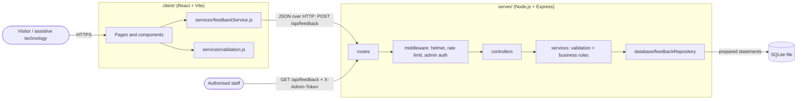

# Architecture

## 1. Project overview

**Accessible Public Service Portal** is a small full-stack application that lets people send feedback about public services. It is the implementation half of the "Accessibility Baseline & Repository Architecture Audit": findings from the audit of the reference site (India Post) are turned into a maintainable, accessible foundation. The reference site is analysed only; it is never modified.

## 2. System architecture



In development the Vite dev server (port 5173) proxies `/api` to Express (port 3001). In production (`npm start`) Express serves the built client from `client/dist`, so browser and API share one origin and no CORS configuration is needed.

## 3. Frontend responsibilities

- Render the pages (home, about, services, feedback, contact) with semantic HTML and an accessible interaction model.
- Validate input quickly for the user (mirrors server rules) and present understandable, accessible errors.
- Call the REST API through one service module, and show loading, success and error states using always-mounted live regions.
- Keep only session-local state (the list of the user's own submissions). It never fetches other people's feedback.

## 4. Backend responsibilities

- Expose the REST API and enforce the rules: validate every request on the server, rate limit submissions, restrict listing of personal data.
- Set security headers (Helmet), cap body size, and translate failures into consistent JSON errors.
- Serve the production client build.

## 5. Database responsibilities

SQLite stores one table, `feedback` (`id`, `full_name`, `email`, `category`, `subject`, `message`, `created_at`). All access goes through `feedbackRepository.js` with parameterised statements. The database file lives in `server/data/` and is git-ignored because it contains personal data.

## 6. API communication

| Method | Path | Purpose | Auth |
| --- | --- | --- | --- |
| GET | `/api/health` | Liveness and database check | None |
| POST | `/api/feedback` | Create feedback (201, or 400 with per-field errors) | None, rate limited |
| GET | `/api/feedback` | List feedback, newest first | `X-Admin-Token`; disabled if `ADMIN_TOKEN` is not set |

Requests and responses are JSON. Errors use `{ "message": "...", "errors": { "field": "..." } }`.

## 7. Folder structure

```text
accessibility-audit/
├── client/                  React + Vite frontend
│   ├── public/              Static assets (favicon)
│   ├── src/
│   │   ├── components/      Reusable UI (Header, FormField, FeedbackForm, ...)
│   │   ├── pages/           Page composition (HomePage)
│   │   ├── services/        API client and client-side validation
│   │   ├── styles/          Design tokens and component CSS
│   │   ├── App.jsx
│   │   └── main.jsx
│   └── index.html
├── server/                  Express API
│   └── src/
│       ├── routes/          URL to controller mapping
│       ├── controllers/     HTTP concerns (status codes, shapes)
│       ├── services/        Validation and business rules
│       ├── database/        SQLite connection, schema, repository
│       ├── middleware/      Rate limit, admin auth, CORS, error handlers
│       ├── app.js           App factory (dependency injection)
│       └── server.js        Process entry point
├── tests/
│   ├── client/              Vitest + Testing Library (jsdom)
│   └── server/              Vitest + Supertest, integration, persistence
├── docs/                    audit-report.md, architecture.md, screenshots/, lighthouse/
├── scripts/                 contrast-check.mjs
├── package.json             npm workspaces and root scripts
└── .env.example
```

## 8. Data flow (feedback submission)

1. The user fills the form; `FeedbackForm` validates it with `validation.js`. Invalid input shows an error summary and inline errors and stops.
2. `feedbackService.submitFeedback` sends `POST /api/feedback` with JSON.
3. Express applies Helmet, the JSON parser (10 kB limit) and the rate limiter, then the controller.
4. The service validates and trims the payload again (the server never trusts the client).
5. The repository inserts the row with a prepared statement and returns `{ id, createdAt }`.
6. The controller replies `201` with a thank-you message and the reference id (no personal data echoed back).
7. The form announces success in a polite live region, resets, and the id is added to the session-local list.

On failure the API returns `400` with field errors (mapped back onto the fields), `429` when rate limited, or `500` with a generic message. Network failures are announced as alerts.

## 9. Separation of concerns

- **Presentation** (components, CSS) does not know how data is stored.
- **Client services** isolate HTTP and validation from components, so components are testable with an injected `submit` function.
- **Routes → controllers → services → repository** each has one job; only the repository contains SQL.
- `createApp({ db, ... })` receives its dependencies, so tests build an app with an in-memory database and no environment variables.
- Tests live in `tests/` mirrored by tier (`client`, `server`) rather than inside the source folders.

## 10. Future scalability

- Replace SQLite with PostgreSQL by re-implementing `feedbackRepository` only (services and controllers stay unchanged).
- Replace the in-memory rate limiter with a shared store (Redis) when running multiple instances.
- Replace the static admin token with real authentication and roles, and add an admin UI.
- Add database migrations, structured logging, and metrics.
- Add CI (lint, tests, Lighthouse CI accessibility budget) and an end-to-end suite (Playwright with axe).
- Add internationalisation (the Indian public-service context needs multiple languages) and a CAPTCHA alternative that is accessible.
