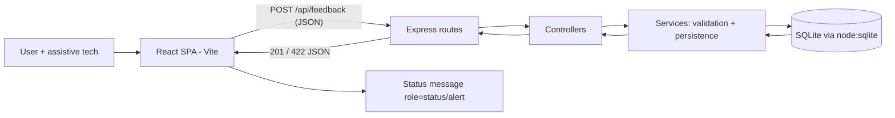

# Architecture

## 1. Project overview
Accessible Public Service Portal is a monorepo containing a React single-page frontend, an Express REST API and a SQLite database. It implements one vertical slice: **submit feedback**.

## 2. System architecture


## 3. Frontend responsibilities (`client/`)
Rendering, client-side validation for fast feedback, accessible error and status presentation, calling the API through `services/api.js`. It never trusts its own validation for security.

## 4. Backend responsibilities (`server/`)
Authoritative validation, persistence, auth for the listing endpoint, consistent JSON errors, security headers, optional static hosting of the built client.

## 5. Database responsibilities
One table, `feedback`, created on startup (`database/db.js`). Parameterised statements only. The file is git-ignored because it holds personal data.

## 6. API communication
JSON over HTTP. In development Vite proxies `/api` to port 4000; in production Express serves both. See README for the endpoint contract.

## 7. Folder structure
```
client/src/{components,pages,styles,services}   UI
server/src/{routes,controllers,services,database}  API
docs/  tests/{client,server}  scripts/
```

## 8. Data flow
1. User submits form. 2. Client validates; on failure shows the error summary. 3. `fetch` POST. 4. Route -> controller -> `validateFeedback`. 5. Invalid: 422 + per-field errors. Valid: `INSERT`, 201 + id. 6. Client shows a `role="status"` success message and clears the form.

## 9. Separation of concerns
Routes map URLs only; controllers handle HTTP; services hold rules and SQL; `database/` owns the connection. `createApp({ db })` takes its dependencies, so tests use an in-memory database.

## 10. Future scalability
Swap SQLite for PostgreSQL behind the same service functions; add rate limiting, CSRF/captcha, pagination and an authenticated admin UI; add i18n (including Indian languages); add CI running tests and Lighthouse CI; add axe-core to the client tests.

## Note on `node:sqlite`
The backend uses Node's built-in SQLite module (Node >= 22.13) so no native compilation is needed. It is marked experimental by Node; migrating to `better-sqlite3` only changes `database/db.js` and the `.prepare` calls remain compatible.
